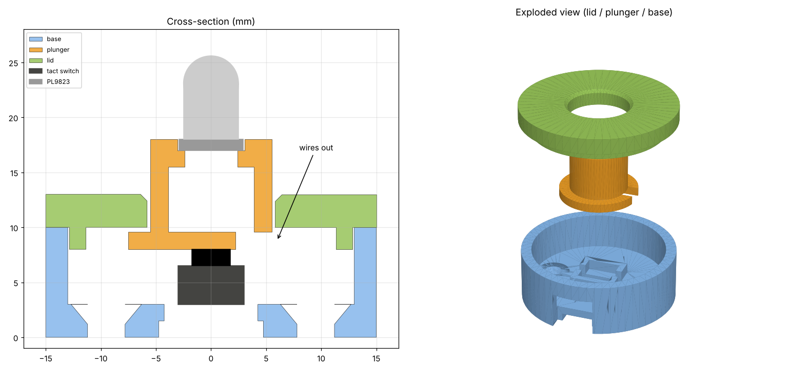

# microplastic_flow

日本周辺4海域のマイクロプラスチック密度データを、ボタンと蛇行させたLEDテープで光の流れとして表現する Arduino プロジェクトです。
An Arduino project that visualizes microplastic density data for four sea regions around Japan as flowing light on a serpentine LED strip, triggered by buttons.

- 増加していれば光が **下から上** へ流れ（暖色）、減少していれば **上から下** へ流れます（寒色）。
  If density increased, light flows **bottom → top** (warm colors); if it decreased, **top → bottom** (cool colors).
- 変化が大きいほど速く流れ、色も濃くなります。
  The bigger the change, the faster the flow and the deeper the color.
- 同じ行のLEDは常に同じタイミング・同じ明るさで光ります。
  LEDs in the same row always light at the same time and brightness.
- 各ボタンの横の目印LED（PL9823）は、押した地点だけがパネルと同じ色で光ります。
  The marker LED (PL9823) next to each button lights in the panel's color for the pressed region.
- データと動きは **CSVファイルを編集するだけ** で変更できます。
  Data and behavior can be changed **just by editing CSV files**.

---

## フォルダ構成 / Folder structure

| ファイル / File | 内容 / Description |
|---|---|
| `microplastic_flow.ino` | スケッチ本体 / Main Arduino sketch |
| `data.h` | CSVから自動生成されるデータ（直接編集しない）/ Data auto-generated from CSV (do not edit) |
| `make_data_h.py` | CSV → `data.h` 変換スクリプト / CSV → `data.h` converter |
| `hardware/` | ボタンモジュールの3Dモデル / 3D model of the button module |
| `japan_4_regionen_interpoliert.csv` | 年×海域のピボット表（中央値・補間済み）/ Year × region pivot table (median, interpolated) |
| `settings.csv` | 動きの設定 / Behavior settings |

> フォルダ名と `.ino` のファイル名は同じにしておく必要があります（Arduino IDE の仕様）。
> The folder name must match the `.ino` file name (Arduino IDE requirement).

---

## 必要なもの / Requirements

### ハードウェア / Hardware

| 部品 / Part | 数 / Qty | 備考 / Notes |
|---|---|---|
| Arduino UNO R4 Minima | 1 | |
| WS2812B LEDテープ / WS2812B LED strip | 150 LEDs | 5V・3線式 / 5V, 3-wire |
| タクトスイッチ（2本足）/ Push buttons (2-pin) | 4 | 地点の数だけ / one per region |
| PL9823 5mm フルカラーLED / PL9823 5 mm RGB LED | 4 | 目印用、地点の数だけ / markers, one per region |
| 抵抗 330Ω（目印LED用）/ 330 Ω resistor (for markers) | 1 | D11のデータ線用 / for the D11 data line |
| セラミックコンデンサ 0.1µF / 0.1 µF ceramic capacitor | 4 | PL9823 1個につき1つ / one per PL9823 |
| 5V ACアダプタ / 5V power supply | 1 | 6〜10A 推奨 / 6–10 A recommended |
| DCジャック2極ターミナル / DC jack terminal | 1 | |
| 抵抗 330Ω / 330 Ω resistor | 1 | データ線用 / for the data line |
| 電解コンデンサ 1000µF / 1000 µF capacitor | 1 | 電源の＋−間 / across power + and − |

### ソフトウェア / Software

- Arduino IDE 2.x
  - ボードマネージャ: **Arduino UNO R4 Boards** / Boards Manager: **Arduino UNO R4 Boards**
  - ライブラリ: **Adafruit NeoPixel** / Library: **Adafruit NeoPixel**
- Python 3（追加ライブラリ不要）/ Python 3 (no extra packages needed)

---

## 配線 / Wiring

```
【ボタン / Buttons】（片足をピン、もう片足をGND。抵抗不要 / one leg to pin, other to GND, no resistor needed）
  CSVの2列目（日本海 / Sea of Japan）           ── D2
  CSVの3列目（東シナ海 / East China Sea）       ── D3
  CSVの4列目（太平洋北部 / Pacific North）      ── D4
  CSVの5列目（太平洋南・中部 / Pacific South）  ── D5
  （5地点目以降 / 5th region and later: D7, D8, D9, D10）
  ※ D6 = LEDテープ / LED strip、D11 = 目印LED / marker LEDs

【LEDテープ / LED strip】
  3本線の 緑 (DIN) / green (DIN) ──[330Ω]── D6
  3本線の 白 (GND) / white (GND) ─────────── Arduino GND
  3本線の 赤 (5V)  / red (5V)    ── × つながない / do not connect

  電源用の赤・白 / extra red & white power wires ── DCジャック端子 / DC jack terminal ── 5V ACアダプタ / 5V PSU
  （端子の＋−間に 1000µF / 1000 µF across + and −）

【目印LED PL9823 / Marker LEDs PL9823】（数珠つなぎ / daisy-chained）
  Arduino D11 ─[330Ω]─ 1個目 DIN / 1st DIN
  1個目 DO / 1st DO ── 2個目 DIN / 2nd DIN
  2個目 DO / 2nd DO ── 3個目 DIN / 3rd DIN
  3個目 DO / 3rd DO ── 4個目 DIN / 4th DIN
  全部の VDD / all VDD ── 5V ACアダプタの＋ / 5V PSU +
  全部の GND / all GND ── GND（Arduinoと共通 / shared with Arduino）
  1個ごとに VDD−GND 間に 0.1µF / 0.1 µF across VDD–GND on each LED
```

### PL9823 の足 / PL9823 pins

```
   平らな面 / flat side
   ┌──────────┐
   │   (LED)  │
   └─┬──┬──┬──┬┘
     1  2  3  4
    DIN VDD GND DO
```

| 足 / Pin | 意味 / Meaning | つなぎ先 / Connect to |
|---|---|---|
| DIN | データ入力 / Data in | D11（330Ω経由）または前のLEDのDO / D11 (via 330 Ω) or previous LED's DO |
| VDD | 電源 ＋5V / Power +5V | 5V ACアダプタの＋ / 5V PSU + |
| GND | グランド / Ground | 共通GND / Shared GND |
| DO | データ出力（= DOUT）/ Data out (= DOUT) | 次のLEDのDIN（最後は空き）/ Next LED's DIN (last one: unconnected) |

> **注意 / Caution:** 足の長さで判断せず、平らな面の位置と購入ページの図で足の順番を確認してください。VDDとGNDを逆につなぐと壊れます。
> Do not judge by leg length — check the pin order using the flat side and the product page diagram. Reversing VDD and GND will damage the LED.

- **Arduinoの5VピンとLEDテープの5Vはつながないでください**（ACアダプタとUSBの電源がぶつかります）。
  **Do not connect the Arduino 5V pin to the strip's 5V** (the PSU and USB power would conflict).
- **GNDは必ず共通にします。**
  **GND must be shared** between Arduino and the strip.
- 150個の場合は、テープの終点側の5V・GNDにも同じ電源から配線すると色ムラが減ります（電源注入）。
  For 150 LEDs, also wire 5V/GND from the same PSU to the far end of the strip to reduce color drift (power injection).

### LEDテープの貼り方 / Strip layout

テープは **一番下の行から始まり**、折り返しながら上へ進むように貼ります（DINが下の行の端）。
Mount the strip so that it **starts at the bottom row** and snakes upward (DIN at the end of the bottom row).

```
  ← ← ← ← ← ← ← ← ← ┐   5行目 / row 5（左端が終点 / ends at left）
┌ → → → → → → → → → ┘   4行目 / row 4
└ ← ← ← ← ← ← ← ← ← ┐   3行目 / row 3
┌ → → → → → → → → → ┘   2行目 / row 2
└ ← ← ← ← ← ← ← ← ←     1行目 / row 1（右端がDIN・始点 / DIN at right）
```

行数・1行のLED数は `microplastic_flow.ino` の次の部分で変更します。
Change the number of rows and LEDs per row in `microplastic_flow.ino`:

```cpp
const uint8_t  NUM_ROWS     = 5;    // 行数 / Number of rows
const uint16_t LEDS_PER_ROW = 30;   // 1行のLED数 / LEDs per row
const uint16_t BEND_LEDS    = 0;    // 折り返し部分のLED数 / LEDs in each bend
```

---

## はじめての書き込み / First upload

1. このリポジトリをダウンロードします（緑の **Code** ボタン → **Download ZIP**、または `git clone`）。
   Download this repository (green **Code** button → **Download ZIP**, or `git clone`).
2. Arduino IDE で `microplastic_flow.ino` を開きます。上のタブに `data.h` も表示されます。
   Open `microplastic_flow.ino` in the Arduino IDE. A `data.h` tab also appears.
3. 「ツール → ボード」で **Arduino UNO R4 Minima**、「ツール → ポート」で接続ポートを選びます。
   Select **Arduino UNO R4 Minima** under Tools → Board, and the connected port under Tools → Port.
4. 書き込みボタン（→）を押します。
   Click the Upload button (→).

`data.h` は生成済みなので、最初は Python を使わずにそのまま書き込めます。
`data.h` is already generated, so you can upload right away without running Python.

---

## 動きを変える / Changing the behavior

### 1. CSVを編集する / Edit the CSV

#### データ / Data: `japan_4_regionen_interpoliert.csv`

```csv
Year,1_Sea_of_Japan,2_East_China_Sea,3_Pacific_North,4_Pacific_South_Central
2014,0.706,1.79,0.112,0.5425
2015,0.497,1.0215,2.11,0.793
...
```

- 1列目は年、2列目以降が地点です。**列の順番がボタンの順番**（D2, D3, D4, D5, D7…）になります。
  Column 1 is the year, columns 2+ are regions. **Column order = button order** (D2, D3, D4, D5, D7…).
- 地点は最大8つまで増やせます。年は連続していれば何年分でも使えます。
  Up to 8 regions. Any number of years can be used as long as they are consecutive.
- 空欄は前後の年から直線で補間されます。
  Blank cells are linearly interpolated from neighboring years.

#### 設定 / Settings: `settings.csv`

`value` 列だけを書き換えます。
Only edit the `value` column.

| key | 初期値 / Default | 説明 / Description |
|---|---|---|
| `show_mode` | `2` | 0=年ごとに再生 / 1=シリアルで年を指定 / 2=2つの年を比較<br>0=play through years / 1=select year via serial / 2=compare two years |
| `compare_from_year` | `2017` | 比較のもとになる年 / Base year of the comparison |
| `compare_to_year` | `2018` | 比較する年 / Year to compare |
| `show_ms` | `10000` | ボタンを押してから光る時間(ms) / Light duration after a press (ms) |
| `trend_mode` | `0` | 0=前年と比較 / 1=`base_year`と比較（`show_mode` 0・1 のとき）<br>0=vs previous year / 1=vs `base_year` (when `show_mode` is 0/1) |
| `base_year` | `2017` | `trend_mode=1` のときの基準年 / Base year when `trend_mode=1` |
| `year_step_ms` | `1500` | `show_mode=0` のときの1年あたりの表示時間(ms) / Time per year when `show_mode=0` (ms) |

> Excelで編集した場合は「**CSV UTF-8（コンマ区切り）**」で保存してください。テキストエディタでの編集が一番安全です。
> If you edit with Excel, save as "**CSV UTF-8 (Comma delimited)**". Editing in a text editor is safest.

### 2. data.h を作り直す / Regenerate data.h

このフォルダで実行します。
Run in this folder:

```bash
# Mac / Linux
python3 make_data_h.py

# Windows
python make_data_h.py
```

成功すると、地点ごとの判定結果が表示されます。
On success, the result for each region is shown:

```
2017 → 2018 の比較 / comparison:
  1_Sea_of_Japan               x 2.84  増加 / increase: 下→上 bottom→top
  2_East_China_Sea             x 2.39  増加 / increase: 下→上 bottom→top
  3_Pacific_North              x 2.68  増加 / increase: 下→上 bottom→top
  4_Pacific_South_Central      x 4.23  増加 / increase: 下→上 bottom→top
```

CSVに誤りがあると理由が表示され、`data.h` は更新されません。
If the CSV has an error, the reason is shown and `data.h` is not updated.

別のCSVを使う場合 / To use other CSV files:

```bash
python make_data_h.py other_data.csv other_settings.csv
```

### 3. 書き込む / Upload

Arduino IDE で `data.h` タブが新しい内容になっていることを確認して書き込みます（古いままならスケッチを開き直す）。
Check that the `data.h` tab shows the new content in the Arduino IDE, then upload (reopen the sketch if it is outdated).

---

## 使い方 / Usage

- ボタンを押すと、その地点のデータでLEDが光ります。光っている間にもう一度押すと消えます。
  Press a button to light the LEDs with that region's data. Press again while lit to turn it off.
- 1枚のパネルを全地点で共有しているので、別のボタンを押すと表示が切り替わります。
  All regions share one panel, so pressing another button switches the display.
- シリアルモニタ（115200 bps）に、年・値・倍率・UP/DOWN が表示されます。
  The Serial Monitor (115200 bps) shows the year, value, ratio, and UP/DOWN.
- `show_mode=1` のときは、シリアルモニタで `2021` のように年を送ると、その年で光ります。
  When `show_mode=1`, send a year such as `2021` via the Serial Monitor to use that year.

### 光り方を変える / Changing the lighting style

`microplastic_flow.ino` の `drawRegion()` だけを書き換えれば変更できます。
Edit only `drawRegion()` in `microplastic_flow.ino`.

| 変数 / Variable | 意味 / Meaning |
|---|---|
| `value` | その年の粒子密度（粒子/m³）/ Particle density of that year (particles/m³) |
| `ratio` | 比較対象に対する倍率（1.5 = 1.5倍、0.5 = 半分）/ Ratio to the comparison (1.5 = 1.5×, 0.5 = half) |
| `dt` | 前フレームからの経過秒 / Seconds since the last frame |

---

## データについて / About the data

`japan_4_regionen_interpoliert.csv` は、AOMI の調査データ（`survey_data.csv`）から次の手順で作成しています。
`japan_4_regionen_interpoliert.csv` was created from AOMI survey data (`survey_data.csv`) as follows:

1. `0192:Particle density_m3 (d<5mm)`（5mm未満の粒子密度）を使用
   Use `0192:Particle density_m3 (d<5mm)` (density of particles < 5 mm)
2. 2014〜2023年、日本周辺（北緯20〜47°、東経122〜155°）に限定
   Limit to 2014–2023 and around Japan (20–47°N, 122–155°E)
3. 緯度・経度で4海域に分類（小笠原は欠測が多いため除外）
   Classify into 4 regions by latitude/longitude (Ogasawara excluded due to missing data)

| 海域 / Region | 条件 / Condition |
|---|---|
| 1 日本海 / Sea of Japan | 北緯38°以上かつ東経140.5°未満、または北緯33.5〜38°かつ東経137°未満<br>≥38°N and <140.5°E, or 33.5–38°N and <137°E |
| 2 東シナ海 / East China Sea | 北緯33.5°未満かつ東経130.5°未満<br><33.5°N and <130.5°E |
| 3 太平洋北部 / Pacific North | 上記以外で北緯37.5°以上<br>Otherwise, ≥37.5°N |
| 4 太平洋南・中部 / Pacific South-Central | 上記以外で北緯37.5°未満<br>Otherwise, <37.5°N |
| （除外 / Excluded）小笠原 / Ogasawara | 北緯29°未満かつ東経139°より東<br><29°N and east of 139°E |

4. 年×海域ごとに中央値を取り、欠損は時間方向に線形補間
   Take the median per year × region and linearly interpolate missing values over time

元データ（`survey_data.csv`）はサイズが大きいため、このリポジトリには含めていません。
The raw data (`survey_data.csv`) is not included in this repository because of its size.

---

## ボタンモジュール（3Dプリント）/ Button module (3D printed)

PL9823を指で押すと、真下のタクトスイッチが押される押しボタン型のケースです。地点ごとに1個ずつ作り、離れた場所に設置します。
A push-button enclosure: pressing the PL9823 with a finger presses the tact switch directly below it. Make one per region and place them separately.



| ファイル / File | 内容 / Description |
|---|---|
| `hardware/led_button_module.scad` | OpenSCADのソース（寸法はここで調整）/ OpenSCAD source (adjust sizes here) |
| `hardware/led_button_base.stl` | 土台：スイッチを入れる / Base: holds the tact switch |
| `hardware/led_button_plunger.stl` | プランジャー：LEDを載せて上下する / Plunger: carries the LED and moves |
| `hardware/led_button_lid.stl` | ふた：プランジャーのガイド / Lid: guides the plunger |

### 寸法の調整 / Adjusting sizes

`.scad` の先頭にある値を、手元の部品をノギスで測って合わせます。
Measure your parts with calipers and adjust the values at the top of the `.scad`.

| 変数 / Variable | 初期値 / Default | 内容 / Meaning |
|---|---|---|
| `led_flange_d` | 5.8 | LED根元のつばの直径 / LED flange diameter |
| `sw_w`, `sw_d` | 6.0 | タクトスイッチ本体の幅・奥行き / Switch body size |
| `sw_h` | 5.0 | スイッチの底からボタン上面まで / Switch height incl. actuator |
| `sw_pin_span` | 6.5 | スイッチの2本の足の間隔 / Distance between switch pins |
| `tol` | 0.3 | はめあいのすき間 / Fit clearance |

STLの書き出し：`part = "base";` などに変えて **F6（レンダリング）→ F7（STL書き出し）**。
Export STL: set `part = "base";` etc., then **F6 (Render) → F7 (Export STL)**.

### 印刷 / Printing

- 3つとも **サポートなし** で印刷できます（ふたは上面を下にした向きで出力されます）。
  All three print **without supports** (the lid is exported upside down).
- 積層 0.2mm、インフィル 20〜30% 程度 / 0.2 mm layers, 20–30% infill.
- プランジャーの上だけ白や半透明で印刷すると、LEDの光が広がって見えます。
  Printing in white or translucent filament spreads the LED light.

### 組み立て / Assembly

1. **スイッチ**：足を土台の底の穴に通し、裏側で線をはんだ付け → 裏のくぼみを通してケーブル穴へ。
   **Switch**: put the pins through the slot in the base, solder wires underneath, route them through the recess to the cable opening.
2. **LED**：PL9823の足を約5mmに切り、4本の線をはんだ付けして熱収縮チューブで絶縁 → プランジャー上面の穴から通し、つばのみぞから外へ出す。LEDは接着剤で固定。
   **LED**: trim the PL9823 legs to ~5 mm, solder 4 wires and insulate with heat-shrink → feed them through the top hole of the plunger and out through the slot in the flange. Glue the LED in place.
3. 線に少しゆとりを持たせて、プランジャーをスイッチの上に置く。
   Leave some slack in the wires and set the plunger on the switch.
4. ふたをかぶせて押し込む（ゆるければ接着）。
   Press the lid on (glue it if loose).
5. 底のM3穴2つで設置面にネジ止め（または両面テープ）。
   Mount with the two M3 holes in the base (or double-sided tape).

### モジュール間の配線 / Wiring between modules

1つのモジュールから出る線は5本です（LED 4本＋スイッチ 1本、GNDは共通）。
Each module has 5 wires (4 for the LED + 1 for the switch, GND shared).

| 線 / Wire | つなぎ先 / Connect to |
|---|---|
| 5V | 5V電源（LEDテープと同じACアダプタ）/ 5V PSU (same as the LED strip) |
| GND | GND（スイッチのもう片方の足もここ）/ GND (also the switch's other pin) |
| DIN | Arduino D11（1個目）または前のモジュールのDOUT / Arduino D11 (1st) or previous module's DOUT |
| DOUT | 次のモジュールのDIN（最後は何もつながない）/ Next module's DIN (unconnected on the last one) |
| SW | Arduino D2 / D3 / D4 / D5 |

```
Arduino D11 ─[330Ω]─ M1 DIN   M1 DOUT ─ M2 DIN   M2 DOUT ─ M3 DIN   M3 DOUT ─ M4 DIN
Arduino D2 ─ M1 SW            D3 ─ M2 SW          D4 ─ M3 SW          D5 ─ M4 SW
```

- 離れた場所に置く場合は、6芯以上のケーブル（LANケーブルなど）が便利です。
  For distant placement, a 6+ core cable (e.g. a LAN cable) is handy.
- モジュール間が2mを超える場合は、各DINの手前にも330Ωを入れると信号が安定します。
  If modules are more than 2 m apart, add a 330 Ω resistor before each DIN for a stable signal.

---

## トラブルシューティング / Troubleshooting

| 症状 / Symptom | 対処 / Fix |
|---|---|
| `python` が見つからない<br>`python` not found | Pythonをインストール（Windowsは「Add to PATH」にチェック）<br>Install Python (on Windows, check "Add to PATH") |
| `data.h: No such file` | `data.h` が `.ino` と同じフォルダにあるか確認<br>Make sure `data.h` is in the same folder as the `.ino` |
| 書き込んでも動きが変わらない<br>Behavior does not change after upload | `make_data_h.py` を実行したか、`data.h` タブが更新されているか確認<br>Check that you ran `make_data_h.py` and the `data.h` tab is updated |
| 上下の向きが逆に見える<br>Flow direction looks reversed | テープの始点（DIN）が下の行にあるか確認<br>Make sure the strip's DIN is on the bottom row |
| 関係ないLEDが光る・チラつく<br>Unrelated LEDs light or flicker | GNDの共通化、330Ω抵抗、テープ電源の抜き差しを確認<br>Check shared GND, the 330 Ω resistor, and power-cycle the strip |
| CSVを編集したらエラーになる<br>Error after editing the CSV | CSV UTF-8で保存し直す。表示されたエラー内容を確認<br>Re-save as CSV UTF-8 and read the error message |
